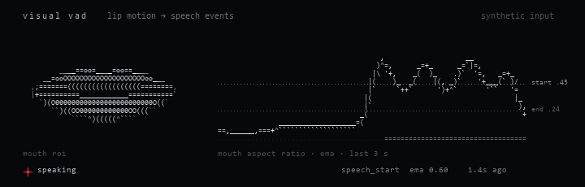

I'm Shreyan, a computer science student specialising in AI & ML at SRM IST, Chennai. Most of what I build sits where models meet real systems: vision pipelines that have to keep up with a webcam, LLM tools that are honest about what they don't know, and backends that survive retries, restarts and bad input.

I like understanding how things work underneath, so I also end up writing terminal tools in Rust, Android apps in Kotlin, game mods and the occasional browser game.

**interests** &nbsp; applied ML & computer vision · LLM systems · backend, async & distributed systems · Android · developer tools · creative frontend

<!-- recent:start -->
lately pushed to &nbsp; [VECTORA](https://github.com/shrenixcodes/VECTORA) nov 12 &nbsp;·&nbsp; [PingSherpa](https://github.com/shrenixcodes/PingSherpa) Python · nov 11 &nbsp;·&nbsp; [pinn-vs-operators](https://github.com/shrenixcodes/pinn-vs-operators) nov 08
<!-- recent:end -->

&nbsp;

## portfolio

**[shrenixcodesportfolio.vercel.app](https://shrenixcodesportfolio.vercel.app/)** &nbsp;·&nbsp; a portfolio you step into: press **L** to enter a 3D room, look around with the mouse, and scroll to send each section (about, education, experience) wrapping around the walls in giant type.

&nbsp;

## selected work

### [Real-time visual voice activity detection](https://github.com/shrenixcodes/Real-Time-Visual-Voice-Activity-Detection)

Python · OpenCV · MediaPipe · NumPy · asyncio · Whisper

A webcam module for a ticket-kiosk agent that decides when the person in front of it is speaking, using only video. It picks one primary user out of everyone in frame (face area and centrality, then IoU tracking so a bystander can't take over), measures lip motion from MediaPipe landmarks, and emits debounced `speech_start` / `speech_end` events. The interesting part is the decision logic: separate start and end thresholds with hold times so it doesn't chatter, and lost faces treated as uncertainty rather than silence. An optional local Whisper stream transcribes only while the visual state says someone is talking. A [standalone version](https://github.com/shrenixcodes/standalone-Visual-Voice-Activity-Detection) exposes the pipeline as bounded `asyncio.Queue` stages behind a small async API.

the same hysteresis, drawn in ASCII on a synthetic signal · [animated version](assets/animations/ascii-secondary.gif)

### [RepoLens](https://github.com/shrenixcodes/Repolens)

Python · TypeScript · Tree-sitter · Docker

Local-first codebase intelligence. Instead of pasting files into a model and trusting its guess, it analyses the repository first: Tree-sitter and `ast` extract symbols, imports and calls into a dependency graph whose edges are marked resolved or unresolved, and search combines lexical, semantic and structural signals. A language model is optional and only explains what the analysis found. Runs offline by default.

### [Shipyard](https://github.com/shrenixcodes/shipyard)

FastAPI · PostgreSQL · SQLAlchemy · Alembic · Docker · GitHub Actions · Prometheus · Grafana

A deliberately small API used to build the full delivery pipeline around it: unit, integration and container smoke tests, Trivy image scanning, publishing to GHCR only after the built image passes its own scan, scripted deployment with automatic rollback, real liveness/readiness separation, and a Prometheus and Grafana stack.

### [Distributed job scheduler](https://github.com/shrenixcodes/Distributed-Job-Scheduler--codity-assignment)

FastAPI · async SQLAlchemy · PostgreSQL · React · Docker

Priority queues with concurrency limits, fixed / linear / exponential retry policies, a dead-letter queue, worker heartbeats with graceful shutdown, and delayed and cron-scheduled jobs, with a React dashboard on top.

### [Neon Rush](https://github.com/shrenixcodes/neon-rush)

TypeScript · React · Phaser 3 · Web Audio

An endless runner where React and Phaser never touch each other's objects and talk only through a small typed event bus. Phaser is loaded lazily, which cut the initial bundle from 1.58 MB to 382 KB. Every visual is drawn procedurally and every sound is synthesised, so the repository has no image or audio files. Includes a seeded daily challenge and a ghost replay of your best run.

<b>more projects</b>

 

| project | what it is | stack |
|---|---|---|
| [multi-agent research pipeline](https://github.com/shrenixcodes/agent-research-pipeline-mercor-capstone) | researcher → analyst → critic → writer, with a critic-driven revision loop and evidence traced back to source passages | Python · Pydantic · Claude API |
| [WindLens](https://github.com/shrenixcodes/q7mx2vk9) | how reliable was a day-ahead UK wind forecast *at the time a buyer had to decide*; no look-ahead, MAE / RMSE / bias against metered generation | FastAPI · React · Elexon API |
| [CivicPulse](https://github.com/shrenixcodes/civicpulse-civic-intelligence) | citizen complaints classified and clustered across English, Hindi and Tamil, ranked by a transparent priority formula | Next.js · Prisma · PostgreSQL |
| [DeepFER](https://github.com/shrenixcodes/deepFER) | facial emotion recognition with a CNN baseline and MobileNetV2 transfer learning, on images, video and webcam | TensorFlow · OpenCV · Flask |
| [prism_multichar](https://github.com/shrenixcodes/prism_multichar) | cinematic character selector for FiveM across Qbox, QBCore and ESX, with server-side validation on every write | Lua · JavaScript |
| [legal case registry](https://github.com/shrenixcodes/Legal-Case-Analysis-Registry-) | full-stack case management and registry | Flask · MySQL |
| [Ferrite](https://github.com/shrenixcodes/ferrite) | terminal system monitor; pre-1.0, see below | Rust · Ratatui |

&nbsp;

## currently exploring

- **[PINNs vs neural operators](https://github.com/shrenixcodes/pinn-vs-operators)** — when does training a neural operator beat re-solving parametric PDEs with FEM or retraining PINNs? A benchmark across Burgers, Darcy flow and heat conduction comparing PINN, DeepONet, FNO and PINO against FEM. Still in the research-foundation phase; no models yet.
- **[Ferrite](https://github.com/shrenixcodes/ferrite)** — a Rust TUI system monitor at v0.2: CPU, memory, disk and network panels, a sortable process table and threshold alerts. Next up: decoupling collection from the render loop, and export.

&nbsp;

## toolbox

| area | tools |
|---|---|
| **languages** | Python, TypeScript / JavaScript, Java, C / C++, Kotlin, Rust, Lua, SQL |
| **ml & vision** | PyTorch, TensorFlow / Keras, scikit-learn, XGBoost, OpenCV, MediaPipe, Whisper |
| **llm systems** | RAG, multi-agent pipelines, typed tool contracts, Claude / Gemini / Vertex AI APIs |
| **backend** | FastAPI, Flask, Node.js, asyncio, SQLAlchemy + Alembic, PostgreSQL, Prisma |
| **frontend** | React, Next.js, Vite, Tailwind, Three.js / React Three Fiber, Phaser |
| **mobile & desktop** | Kotlin, Jetpack Compose, Room, WorkManager, Electron, Ratatui |
| **infra** | Docker, GitHub Actions, Prometheus, Grafana, Google Cloud, Linux |

&nbsp;

## experience

| role | when | what |
|---|---|---|
| **Junior AI Intern** · BlockRank | Jul – Oct 2026 | fine-tuned and deployed LLMs; built RAG systems, AI APIs and agent workflows |
| **AI/ML Intern** · Labmentix | Jul – Sep 2026 | EDA through to models on vaccination, tourism, EMI, facial emotion and Flipkart data |
| **Data Science Intern** · Yuva Intern × Henry Harvin | | the full data science lifecycle, ending in an end-to-end capstone |
| **Robotics & Controls job simulation** · Johnson & Johnson MedTech | Jun 2026 | debugged control-system delays with Python tooling |
| **AI Research Intern** · Agnirva Space Community | Feb – Apr 2025 | report on AI for space exploration and satellite systems |
| **B.Tech CSE (AI & ML)** · SRM IST, Chennai | 2023 – present | |

**certifications** &nbsp; JPMorgan software engineering simulation · Google: Applying AI Principles, Generative AI · Vertex AI prompt design · Deloitte data analytics · Tata GenAI analytics · Mercor: intro to agents · NPTEL machine learning (IIT Kharagpur) · Cisco networking · C & C++ (Udemy)

&nbsp;

## activity

generated from the GitHub API by [scripts/stats.py](scripts/stats.py), refreshed daily by a GitHub Action

&nbsp;

---

**[portfolio](https://shrenixcodesportfolio.vercel.app/)** &nbsp;·&nbsp; **[github](https://github.com/shrenixcodes)** &nbsp;·&nbsp; **[linkedin](https://linkedin.com/in/shreyan-bag-a81328351)** &nbsp;·&nbsp; **[email](mailto:subhoberh2004@gmail.com)**

