 

<table>
<tr>
<td width="45%" align="center">

</td>
<td width="55%">

**✦ ── hi, i'm shreyan ── ✦**

b.tech cse **(ai & ml)** student. i teach computers to think
so i don't have to.

i build ai systems, full-stack web apps, android apps,
terminal tools and game mods, mostly to avoid doing things manually.
i care a lot about how things *look* and *feel*, which is why my css has trust issues.

- ✦ ex-junior ai intern @ **blockrank** (the llms survived. mostly.)
- ✦ 5 internships & job sims cleared (my sleep schedule did not)
- ✦ fluent in python, java, c++ and reading stack traces at 2am

† currently: shipping side projects at 3am and calling it "work-life balance"

</td>
</tr>
</table>

**✦ ── s k i l l &nbsp; t r e e ── ✦**

things i've googled enough times to call myself proficient

<table>
<tr><td><b>† languages</b></td><td>python · java · c · c++ · kotlin · typescript · javascript · rust · lua · sql · html · css</td></tr>
<tr><td><b>† ai / ml</b></td><td>machine learning · deep learning · tensorflow / keras · pytorch · scikit-learn · xgboost · model evaluation · feature engineering</td></tr>
<tr><td><b>† llms & gen ai</b></td><td>llm fine-tuning · rag systems · agentic ai workflows · ai apis & chatbots · prompt engineering · vertex ai · speech-to-text (whisper)</td></tr>
<tr><td><b>† computer vision</b></td><td>opencv · mediapipe · face detection & tracking · facial emotion recognition · lip-motion / visual vad</td></tr>
<tr><td><b>† data</b></td><td>data analysis · pandas · numpy · matplotlib · seaborn · plotly · streamlit · eda · data cleaning · clustering · data visualization</td></tr>
<tr><td><b>† frontend</b></td><td>full-stack development · react.js · next.js · vite · tailwind css · three.js · react three fiber · phaser · zustand · recharts</td></tr>
<tr><td><b>† backend</b></td><td>fastapi · flask · node.js · rest apis · asyncio · prisma · sqlalchemy · alembic · postgresql · sqlite</td></tr>
<tr><td><b>† android & desktop</b></td><td>kotlin · jetpack compose · room · workmanager · electron · rust tuis (ratatui)</td></tr>
<tr><td><b>† devops & cloud</b></td><td>cloud applications · google cloud · docker · docker compose · ci/cd · prometheus · vercel · git · github · linux</td></tr>
<tr><td><b>† testing</b></td><td>pytest · vitest · unit testing</td></tr>
<tr><td><b>† game dev & modding</b></td><td>fivem (qbox · qbcore · esx) · minecraft plugins (gradle · maven) · browser games</td></tr>
<tr><td><b>† design</b></td><td>ui/ux design · creative coding · motion & glitch effects</td></tr>
<tr><td><b>† core</b></td><td>data structures & algorithms · problem solving · adaptability</td></tr>
</table>

  

**✦ ── s t a t i s t i c s ── ✦**

numbers that prove i should touch grass more often

<i>「 it's not a bug, it's a side quest. 」</i> 
<i>「 code is never finished. it just stops crashing long enough to push. 」</i> 
<i>「 it works on my machine. we are not shipping my machine. 」</i>

  

  

